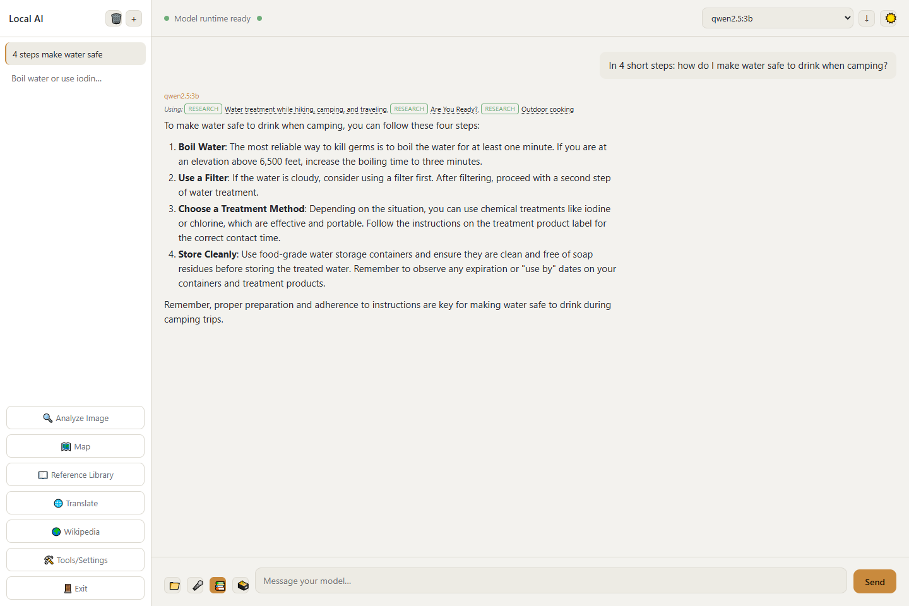
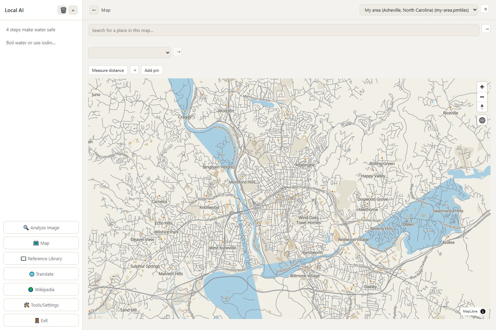
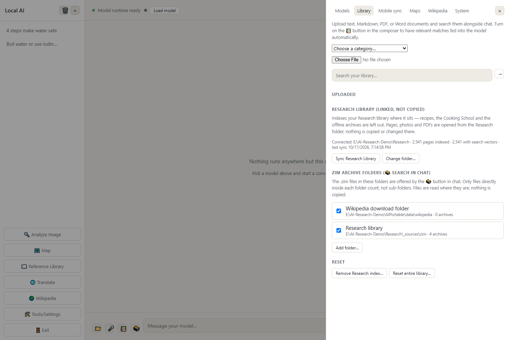

# AIPortable

An AI assistant that runs entirely on your own computer: chat with local AI models, ask questions about your own
documents, search offline Wikipedia and other reference archives while it answers, browse offline maps, and
read Wikipedia without the internet.

▶ **[Watch the feature tour on YouTube](https://youtu.be/AcBpQHDESII)** - it shows AIPortable-JustAI, the slim version of this app; chat, library and archive search work the same here, and this version adds maps and Wikipedia.

No account, no cloud, no telemetry. The whole app, including its models, chats and data, lives in **one folder**
that you can move to another drive or carry on a USB stick.

## What it looks like

<table>
<tr><td width="50%"><br><sub>An answer from your own library (📚) - the pages it used are listed above it</sub></td><td width="50%"><br><sub>Offline map of your area (the 'My area' region)</sub></td></tr>
<tr><td width="50%"><br><sub>Tools/Settings → Library: the linked Research library and archive folders</sub></td></tr>
</table>

*Pictures from a demo library built from scratch with these tools (starter-pack samples, a few recipes, a Local Area for Asheville, NC).*

---

## How the apps fit together

There are four separate downloads. They work on their own, and better together when they sit side by side in
one folder.

| App | What it is | Do you need it? |
|---|---|---|
| **AIPortable** (this one) | Offline AI chat with your library, Wikipedia viewer and offline maps | Pick **one** of the two AI apps |
| **AIPortable-JustAI** | The same AI chat without the maps and Wikipedia viewer (smaller) | Pick **one** of the two AI apps |
| **Research** | A large offline reference library and Library Manager, the window for building it | Optional - adds a big searchable library to the AI |
| **LibraryViewer** | A read-only copy of the Research library for an Android tablet | Optional |

Most people use **either** AIPortable **or** JustAI, not both. Choose AIPortable if you want offline maps and
the built-in Wikipedia reader; choose JustAI if you only want the AI chat. Research and LibraryViewer are add-ons.

Put the ones you use in **one folder**, side by side:

```
AI-Research\
    AIPortable\          this app
    Research\            optional library
    LibraryViewer\       optional tablet viewer
```

The apps find each other by that layout. The folder can be anywhere (another drive, a USB drive). Avoid
OneDrive-synced folders.

---

## Setting up from scratch

**You need:** Windows 10 or 11 (64-bit) and an internet connection for setup. Disk space: about 3 GB for the
app and its tools, plus the AI models you choose (2 - 20 GB each) and any maps (40 MB to tens of GB).

1. **Get the folder.** Download this repository (green **Code** button → *Download ZIP*, then unzip), or with git:
   `git clone https://github.com/DFranke84/AIPortable`.
2. **Double-click `Setup-Windows.bat`.** It asks two questions first, then runs on its own:
   - **which AI model to download** - it detects your graphics card's memory and shows the models that fit
     (the first *General* model is a good start);
   - **which map regions to download** - or press Enter to skip.

   It then downloads everything else into this folder - no admin rights, nothing installed on the rest of the PC:
   the app's own runtime, [Ollama](https://ollama.com) (runs the AI models), Kiwix (reads offline archives),
   voice input, and a small search model used for your documents. It takes a while the first time; you can walk
   away. Safe to run again: it only fills in what's missing.
3. **Double-click `AIPortable.vbs`** to start the app.

Step by step, all options and troubleshooting: **[SETUP.md](SETUP.md)**.


**Testing a fresh install?** [TESTING.md](TESTING.md) is a step-by-step checklist for setting all the apps up from scratch in a test folder - no experience needed.

---

## What you can do

**In the chat**

- **Chat** with the AI model you picked. Chats are saved and titled automatically; rename, delete, or export
  one to a text file (↓). **Load model** gets the model ready before your first question.
- **📁 Attach** a picture (for models that can see images), a PDF, Word or text file to one message.
- **📚 Use your library**: the AI looks through your documents first and answers from them, showing which ones
  it used.
- **🗃️ Search archives**: the AI searches offline archives (Wikipedia, MedlinePlus, Stack Exchange…) before
  answering. *Quick* does one search with any model; *Thorough* lets models that can use tools search and open
  articles themselves.
- **🎤 Voice input**: speak instead of typing (runs locally).

**In the sidebar**

- **📖 Reference Library**: your own documents. Add files in 🛠️ Tools/Settings → Library; read them here.
- **🌍 Wikipedia**: read offline Wikipedia or any other `.zim` archive, with pictures and search. Download
  archives in Tools/Settings → Wikipedia.
- **🗺️ Map**: offline maps with place search, saved pins and distance measuring. Download regions in
  Tools/Settings → Maps.
- **🔍 Analyze Image**: identify what is in a photo, checked against your library.
- **🌐 Translate**: typed text, or the text in a picture.
- **🛠️ Tools/Settings**: models, library, maps, Wikipedia, phone access, system.
- **🚪 Exit**: closes the app and frees the memory the AI models were using (or keeps them loaded, if you tick
  that).

**From your phone**: Tools/Settings → Mobile sync starts a small page your phone can open on the same Wi-Fi to
chat with the app. Only use it on a home network you trust; it has no password.

---

## Your documents: two kinds of library

- **The app's own Reference Library** - documents you add inside the app (Tools/Settings → Library). Good for a
  handful of your own files.
- **The Research library** - a separate, much larger library built with Library Manager (the Research download).
  When a `Research` folder sits next to the app, the app offers to **Sync** it; or use Tools/Settings → Library →
  **Sync Research Library** (and **Change folder…** if it is somewhere else). The app reads it where it is -
  nothing is copied - and 📚 then answers from both. Sync again after adding things in Library Manager.

The archives in the Research library's `_sources\zim` folder are offered to 🗃️ automatically. You can add other
archive folders in Tools/Settings → Library → *ZIM archive folders*.

---

## Choosing AI models

Tools/Settings → Models lists models that fit your graphics card (pick your card's memory size: 4, 8, 12, 24 or
32 GB) with a download button for each. Bigger models know more but need more memory and answer more slowly.
The lists are plain files in `data\` (`4K-models-catalog.json` … `32K-models-catalog.json`) that you can edit.

Models are kept in `data\models`. On a slow USB drive you can move them to a folder on the PC (Tools/Settings →
Models → *Choose folder on this PC*) and copy them back and forth with the Sync buttons.

Ollama runs the models and is built in. If you prefer **LM Studio**, Tools/Settings → Models lets the app use
LM Studio's local server for chat instead.

---

## Parts built for one person's setup

- The **map list** starts with the first owner's local area (Flathead Valley and Montana) before the US, Canada,
  Europe, Asia & Pacific and World regions. The Research library's `Build Local Area.bat` adds a **My area** region
  for your own town at the top; or add one by hand to `data\maps-catalog.json` (a name and a bounding box - see
  [SETUP.md](SETUP.md)).
- The model lists include a **Survival** category chosen for practical, preparedness-style questions.

---

## Where things are kept

Everything is inside this folder:

| Folder | What |
|---|---|
| `data\` | Your chats (`chats.db`), your Reference Library (`library.db`, `library\`), models (`models\`), maps (`maps\`), Wikipedia archives (`wikipedia\`), and the editable model / map / Wikipedia lists |
| `resources\` | Ollama, Kiwix, voice input and the map tool (downloaded by setup) |
| `node_modules\`, `runtime\` | The app's own runtime (downloaded by setup) |

A few per-PC choices (window size, where models are kept on this PC, the Research folder) are remembered on each
computer separately, so the same USB drive works on several PCs.

Copy the whole folder to move or back up the app. To start fresh, delete `data\chats.db` and `data\library.db`
(they are recreated empty).

---

**Detailed setup, options, troubleshooting and technical notes:** [SETUP.md](SETUP.md).

## License

Free to use, change and share under the [MIT License](LICENSE). Bundled third-party parts (PDF.js, MapLibre,
PMTiles, marked, Noto fonts, and the Ollama / Kiwix / whisper programs that setup downloads) keep their own
open-source licenses.
